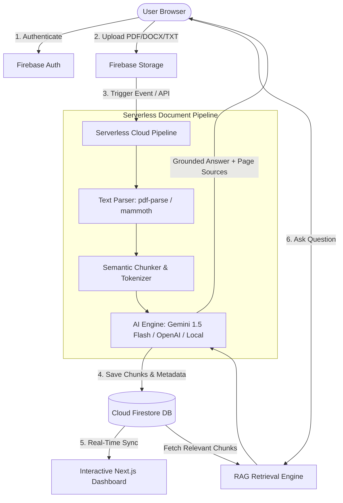

# 🚀 DocuMind AI
### **AI-Powered Cloud Document Analyzer**
> **Tagline:** *Upload. Understand. Ask.* | *Turn Cloud Documents Into Intelligent Insights.*

A full-stack, cloud-native Document Intelligence platform engineered as a **B.Tech Cloud Computing & Artificial Intelligence Mini Project**. DocuMind AI allows users to upload documents (PDF, DOCX, TXT) to secure multi-tenant cloud storage, automatically extract text via serverless pipelines, generate executive summaries, and interact with documents through grounded **Retrieval-Augmented Generation (RAG)** Q&A with verifiable page and chunk citations.

---

## 📌 Table of Contents
1. [Project Overview](#-project-overview)
2. [Key Differentiating Features](#-key-differentiating-features)
3. [Cloud Architecture & Diagram](#-cloud-architecture)
4. [RAG (Retrieval-Augmented Generation) Pipeline](#-rag-pipeline)
5. [Tech Stack](#-tech-stack)
6. [Cloud Security & Data Isolation](#-cloud-security--data-isolation)
7. [Firestore Database Schema](#-firestore-database-schema)
8. [Folder Structure](#-folder-structure)
9. [Getting Started & Local Setup](#-getting-started--local-setup)
10. [Configuration (Firebase & AI)](#-configuration)
11. [B.Tech Viva Evaluation Q&A](#-btech-viva-evaluation-qa)

---

## 🌟 Project Overview

Traditional file viewers require manual, time-consuming reading to locate answers or extract insights. **DocuMind AI** solves this by uniting **Cloud Computing** (Storage, NoSQL Database, Serverless Functions, Identity) with **Generative AI & Semantic Retrieval**.

### Supported File Types:
- **PDF** (`.pdf` up to 20MB)
- **DOCX** (`.docx` up to 20MB)
- **TXT** (`.txt` up to 10MB)

---

## ⭐ Key Differentiating Features

1. **Document Upload & Cloud Storage:** Multi-tenant file upload with live progress, file type validation, and user-isolated cloud paths (`documents/{userId}/{documentId}/original/...`).
2. **Automated Serverless Text Extraction & Chunking:** Semantic chunking with sliding context overlap (150 chars) and page index approximations.
3. **AI Document Understanding:** Executive summary, detailed breakdown, 5 key points, technical topics, frequency keywords, difficulty classification, and sentiment.
4. **Flagship RAG Chat:** Ask natural language questions grounded in document chunks. Includes starter prompts and source citations: `Page 4 • Chunk 3`.
5. **Document Comparison:** Select two documents to discover common themes, divergent topics, architectural trade-offs, and unique insights.
6. **AI Executive Report Generator:** Exportable and printable PDF-ready summary sheets with full Q&A transcripts.
7. **Cloud Analytics & Insights:** Dynamic Recharts graphs showing upload trends, file format breakdowns, and topic distribution.
8. **Admin Telemetry Console:** System-wide metrics, serverless function latency, storage consumption, and role-based access.
9. **Zero-Barrier Viva Demo Mode:** Works out-of-the-box with pre-seeded documents even before setting up external GCP or AI API keys!

---

## ☁️ Cloud Architecture



### Text Architecture Flow
```text
                    ┌──────────────────┐
                    │      USER        │
                    └────────┬─────────┘
                             │
                             ▼
                    ┌──────────────────┐
                    │   Next.js App    │
                    └────────┬─────────┘
                             │
             ┌───────────────┼────────────────┐
             │               │                │
             ▼               ▼                ▼
      Firebase Auth    Firebase Storage   Firestore
             │               │                │
             └───────────────┼────────────────┘
                             │
                             ▼
                    Cloud Functions
                             │
                    ┌────────┴────────┐
                    ▼                 ▼
             Document Parser      AI Service (Gemini / OpenAI)
                    │                 │
                    └────────┬────────┘
                             ▼
                      Analysis Results
                             │
                             ▼
                       User Dashboard
```

---

## 🧠 RAG Pipeline (Retrieval-Augmented Generation)

To eliminate hallucinations and prevent exceeding token boundaries:
1. **Extraction:** Plain text is extracted from the uploaded document binary.
2. **Chunking:** Text is broken down into structured semantic windows (~1,000 characters) with a 150-character overlap.
3. **Retrieval Scoring:** Queries are tokenized, filtered against stop words, and scored using TF-IDF / BM25 term weighting and exact phrase heuristics.
4. **Prompt Augmentation:** Only the Top-K relevant chunks are injected into the prompt.
5. **Grounded Response:** The AI model is strictly constrained to cite facts from provided excerpts or return *"I couldn't find enough information about this in the uploaded document."*

---

## 🛠️ Tech Stack

- **Frontend & App Framework:** Next.js 14 (App Router), TypeScript, React 18
- **Styling:** Tailwind CSS, Glassmorphism, CSS Custom Tokens (Dark & Light mode)
- **Icons & Animations:** Lucide React, Framer Motion
- **Data Visualizations:** Recharts (Bar charts, Donut charts, Topic clouds)
- **Cloud Infrastructure:**
  - **Firebase Authentication** (Email/Password, Google Sign-in, RBAC)
  - **Cloud Firestore** (NoSQL Document Store, composite indexes)
  - **Firebase Storage** (User-isolated object bucket)
  - **Firebase Cloud Functions** (Serverless backend event processing)
  - **Firebase Hosting** (Edge deployment)
- **AI Integration:** Google Gemini (`gemini-1.5-flash`), OpenAI compatible endpoints, and Built-in High-Fidelity NLP Fallback engine.

---

## 🔒 Cloud Security & Data Isolation

DocuMind AI implements Zero-Trust multi-tenant isolation:
- **Storage Rules (`storage.rules`):** Ensures documents can only be written and read at `documents/{userId}/{documentId}/...` where `request.auth.uid == userId`.
- **Database Rules (`firestore.rules`):** Prohibits cross-tenant reads or writes across `documents`, `analyses`, and `chatMessages`.
- **Server-Side API Keys:** AI credentials are never bundled in client Javascript.

---

## 📂 Firestore Database Schema

```text
users/{userId}
  - uid: string
  - email: string
  - displayName: string
  - role: 'user' | 'admin'
  - createdAt: timestamp

documents/{documentId}
  - id: string
  - userId: string
  - fileName: string
  - fileType: 'pdf' | 'docx' | 'txt'
  - fileSize: number
  - storagePath: string
  - status: 'uploaded' | 'processing' | 'analyzed' | 'failed'
  - pageCount: number
  - textLength: number
  - createdAt: timestamp

documentAnalyses/{analysisId}
  - documentId: string
  - userId: string
  - shortSummary: string
  - detailedSummary: string
  - keyPoints: string[]
  - topics: string[]
  - keywords: string[]
  - documentType: string
  - difficulty: string
  - sentiment: string

documentChunks/{chunkId}
  - documentId: string
  - chunkIndex: number
  - pageNumber: number
  - text: string
  - tokensCount: number

chatMessages/{messageId}
  - sessionId: string
  - sender: 'user' | 'assistant'
  - content: string
  - sources: [{ pageNumber: number, chunkIndex: number, snippet: string }]
  - timestamp: timestamp
```

---

## 🚀 Getting Started & Local Setup

### 1. Clone & Install
```bash
git clone <repo-url>
cd cloude56
npm install
```

### 2. Configure Environment (`.env.local`)
Copy `.env.example` to `.env.local`:
```bash
cp .env.example .env.local
```

### 3. Run Development Server
```bash
npm run dev
```
Open [http://localhost:3000](http://localhost:3000) in your browser.

---

## 🔑 Configuration

### Running with Google Gemini API:
1. Obtain an API key from [Google AI Studio](https://aistudio.google.com/).
2. In `.env.local`:
   ```env
   AI_PROVIDER=gemini
   GEMINI_API_KEY=AIzaSy...
   ```

### Running with Firebase:
1. Create a project at [Firebase Console](https://console.firebase.google.com/).
2. Enable **Authentication**, **Cloud Firestore**, and **Firebase Storage**.
3. Copy Web App credentials into `.env.local`.

*(Note: If Firebase credentials are not provided, DocuMind AI seamlessly switches to built-in Demo Mode with full local persistence, pre-loaded notes, and zero errors!)*

---

## 🎓 B.Tech Viva Evaluation Q&A

**Q1: What cloud computing characteristics are demonstrated in this project?**
> On-demand self-service (instant document processing), broad network access (responsive web UI), resource pooling (multi-tenant Firestore & Storage), rapid elasticity (serverless functions), and measured service (cloud storage quota monitoring).

**Q2: How does RAG prevent AI hallucinations?**
> RAG retrieves verified semantic text chunks from the document and strictly instructs the LLM to ground its output within those excerpts, citing page numbers and chunk IDs.

**Q3: How is multi-tenant security guaranteed in Firebase?**
> By binding Firestore and Firebase Storage paths to `request.auth.uid`. A user cannot read or delete another user's document even if they know the document ID.
# cloudeproject3
